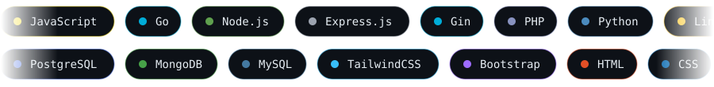

<div align="center">





<br/>


</div>

<br/>

<table>
<tr>
<td width="50%" valign="top">

### `01` · now
```diff
+ learning Golang (Gin)
+ designing cleaner REST APIs
+ building developer tools
- stop overengineering
```

</td>
<td width="50%" valign="top">

### `02` · ask me about
```yaml
web_development: true
apis: true
developer_tools: true
fun_fact: "I can move my ears"
```

</td>
</tr>
</table>

<br/>

### `03` · live stats

<div align="center">


</div>

<br/>

### `04` · contribution snake

<div align="center">

<picture>
  <source media="(prefers-color-scheme: dark)" srcset="https://raw.githubusercontent.com/JohannesMRS/JohannesMRS/output/github-snake-dark.svg" />
  
</picture>

<br/>

```go
defer fmt.Println("thanks for stopping by.")
```

</div>